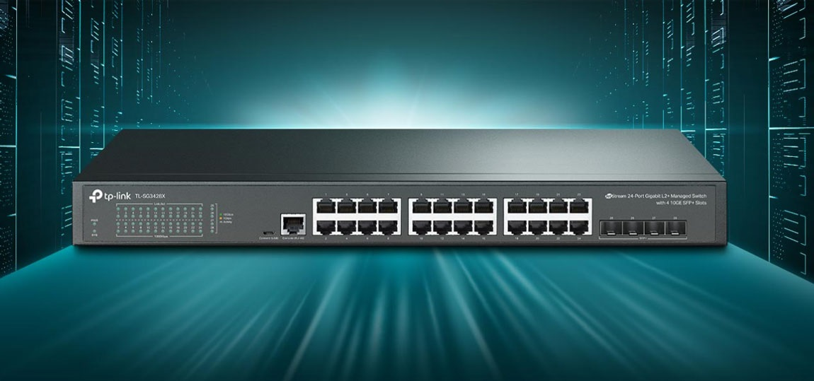

# Vitajte v elektronickej učebnici!

Táto učebnica je venovaná počítačovým sieťam.

## Hello World! test:

Ak vidíte tento text, Zensical funguje správne.

Otestujeme prehrávanie videa uloženého na Nextcloude.

## 1. Natívne video v Zensicale

## Test Obrazku

## 1. Obrázok z Nextcloudu cez Markdown

## Ako sa učí sieťový prepínač?

Sieťový prepínač sa učí MAC adresy
z prichádzajúcich ethernetových rámcov.

??? question "Z ktorej MAC adresy sa prepínač učí?"

    Prepínač si zapamätáva **zdrojovú MAC adresu**
    rámca a port, na ktorom rámec prijal.

??? question "Čo sa stane, ak nepozná cieľovú MAC adresu?"

    Rámec odošle cez všetky ostatné porty
    v príslušnej VLAN, okrem portu,
    na ktorom ho prijal.

!!! success "Hotovo!"

    Naša prvá elektronická učebnica funguje!
